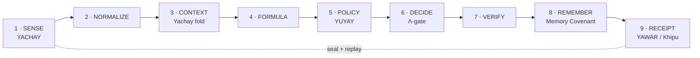

<!-- szl:header v1 -->
<!-- Native identity: szl-brand@4309f6fce89179331b0b3ed8c99494e76c5be256; Orbit v2 icon. -->

  

**Control before action. Evidence after.**

[Product](https://a-11-oy.com) · [Proof](https://a11oy.net) · [GitHub organization](https://github.com/szl-holdings)
<!-- /szl:header -->

# The Governed Agent Reference Model

**Version 0.1 · Open reference model · SZL Holdings (Doctrine v11)**

*A one-page open model. Give the model away; sell the control plane. Reference implementation: [a11oy](https://github.com/szl-holdings/a11oy) · [puriq-live](https://github.com/szl-holdings/puriq-live).*

## The model

Every governed agent is nine organs. Each organ has a job, a receipt boundary, and a failure mode. The model names the layers so that "which organ is ungoverned in your agent stack?" becomes a question with an answer.

## The nine organs

| # | Organ | Job | Ungoverned looks like | Who does it today |
| --- | --- | --- | --- | --- |
| 1 | **SENSE** (Yachay) | Bind to fixed, named sources; refuse caller-supplied URLs | Silent prompt/context injection | RAG pipelines, MCP fetchers |
| 2 | **NORMALIZE** | Strict schema/numeric normalization; explicit UNAVAILABLE degradation | Coerced or clipped garbage in, confident garbage out | ingestion frameworks |
| 3 | **CONTEXT** | Governed memory and retrieval — handles outside, hydration inside the trusted controller | Unaudited vectors shaping every answer | Mem0, Zep, Letta (capability only) |
| 4 | **FORMULA** | Locked, versioned descriptive formulas | Unversioned prompt magic | prompt engineering folklore |
| 5 | **POLICY** (Yuyay) | Deny-by-default gate over every organ transition; versioned, committed rules | guardrails-as-demo | Llama Guard–style filters |
| 6 | **DECIDE** (Λ-gate) | Aggregate axis scores with axiom self-checks; abstain on insufficiency | Confident decisions with no trace of why | routers, orchestrators |
| 7 | **VERIFY** | Evidence must already exist before review; REVIEW / ABSTAIN only | Post-hoc vibes | evals platforms (LangSmith, Arize) |
| 8 | **REMEMBER** (Memory Covenant) | Receipted writes and recalls; review-gated learning | Agents rewriting their own memory silently | **nobody — the frontier** |
| 9 | **RECEIPT** (Yawar / Khipu) | Seal the run: DSSE-signed, hash-chained, replayable offline | logs that assert but cannot prove | **nobody at runtime** |

## Three rules that make it a model

1. **Every organ transition emits a receipt.** An organ without a receipt boundary is an organ without evidence — name it ungoverned.
2. **Truth has tiers.** MEASURED / REPORTED / MODELED / UNAVAILABLE — and UNAVAILABLE is a valid answer. A fabricated value anywhere in the chain poisons every receipt above it.
3. **Approval is not sovereignty.** A human can accept review-required evidence; a human can never lift a hard deny. Sovereignty is the policy, not the override.

## How vendors map in

Cited leaders of a job — SZL takes the job, never the code: vLLM and the inference runtimes serve SENSE/NORMALIZE; Llama Guard–class filters serve POLICY (as advisory, not sovereignty); LangSmith/Arize serve VERIFY (as observation, not proof); Mem0/Zep/Letta serve CONTEXT (as capability, not covenant); Sigstore/DSSE serve RECEIPT (as format, not runtime). **The market has every organ as a product and no product as the organism.** The reference model is the organism diagram; a11oy is the organism.

## Adoption

- **License:** text CC BY 4.0 / code Apache-2.0; conformance checklist in [ORGAN-CHECKLIST.md](ORGAN-CHECKLIST.md), aligned with the Memory Covenant conformance suite.
- **Self-assessment:** map your stack to the nine organs; every organ missing a receipt boundary is your procurement gap.
- **Certification:** Decision-SLSA v1.4 maturity mapping, attestation grades with expiry (evidence-doctrine) — claim a level only with receipts.

---

*Doctrine v11 · Control before action. Evidence after. Λ = Conjecture 1 (never a closed theorem).*
